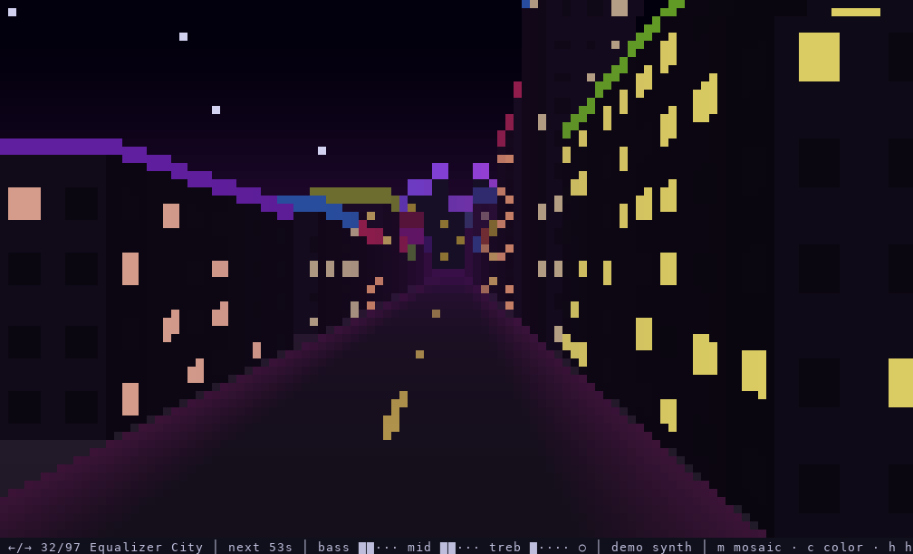
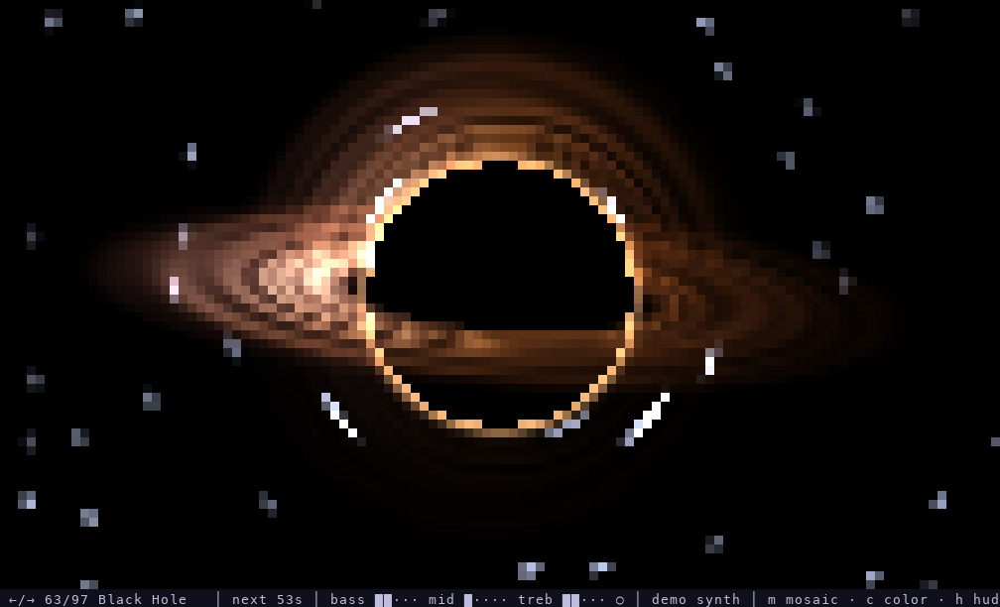
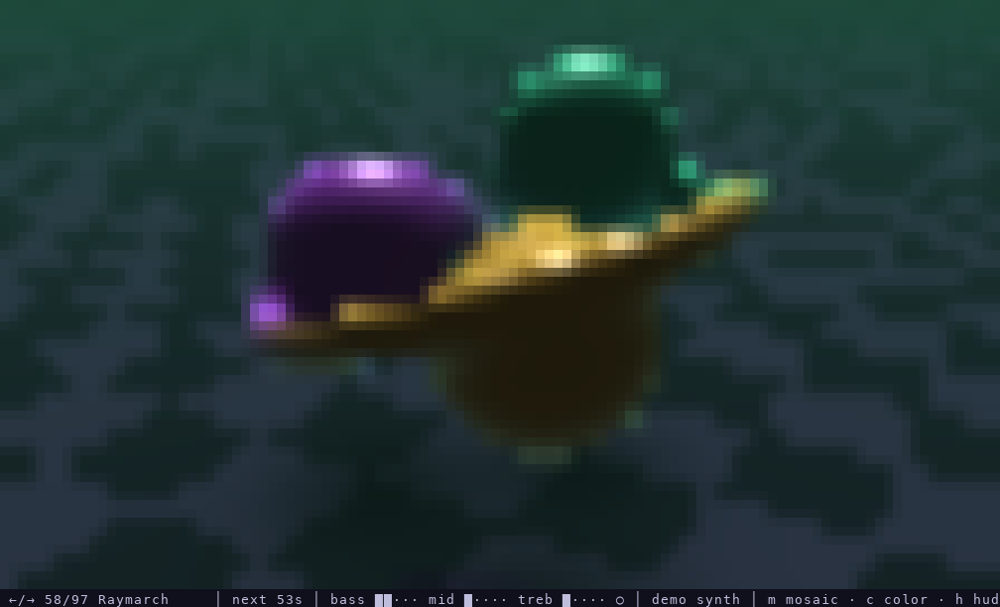
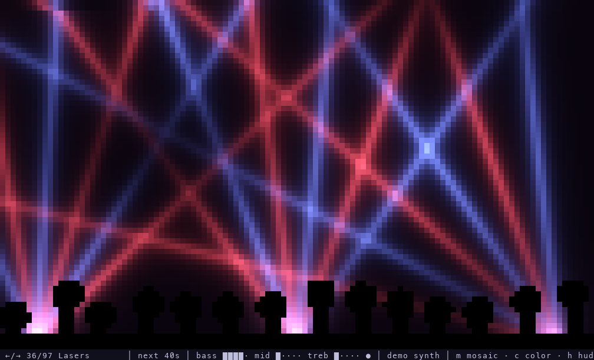
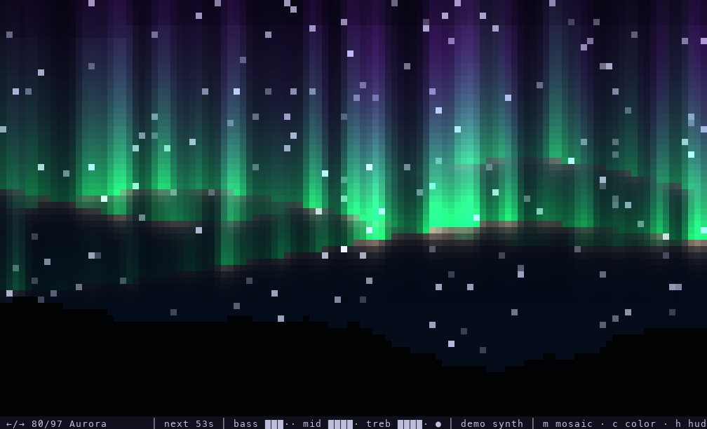
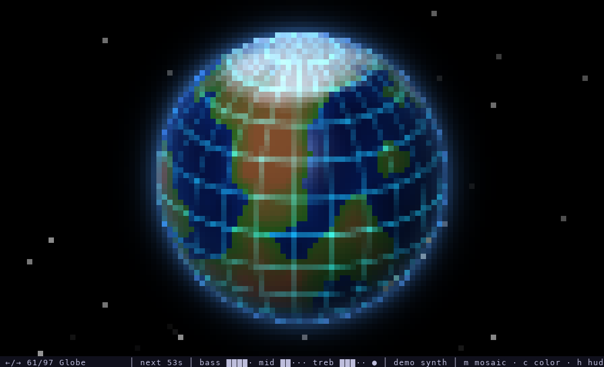
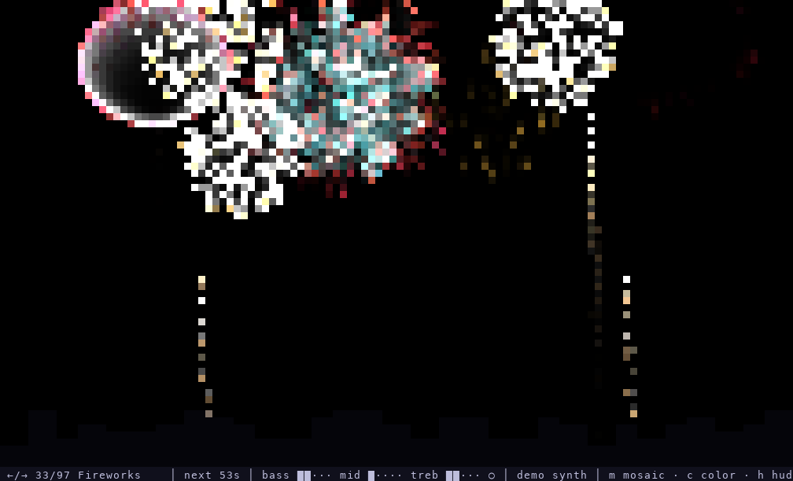
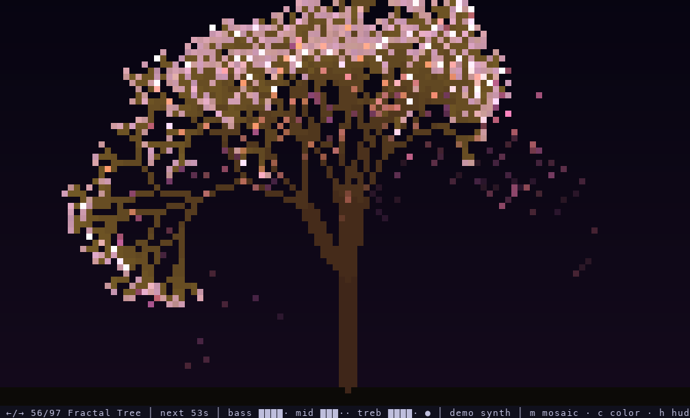
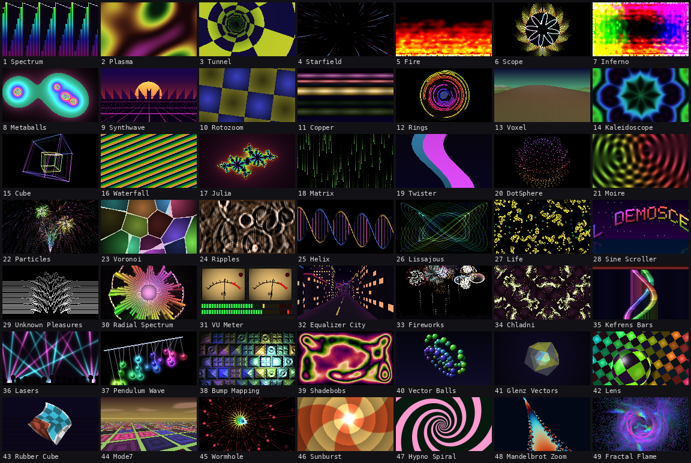
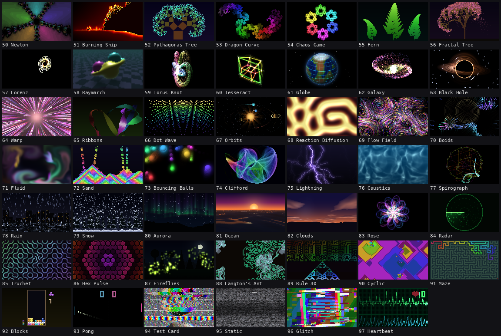

# SoundScene

[](https://github.com/voidNK/SoundScene/actions/workflows/ci.yml)
[](https://github.com/voidNK/SoundScene/releases/latest)
[](LICENSE)

Old-school demoscene effects in your terminal, driven by whatever music you're playing.

I wanted something to put on a second screen while music is running: a plasma that speeds up with the bass, a tunnel that lurches forward on every kick, a fire that gets taller when the track gets louder. It runs in any truecolor terminal, needs no GPU, and on macOS it can listen straight to a single app (like the Chrome tab playing your music) without any loopback-driver setup.


| | |
|---|---|
|  |  |
|  |  |
|  |  |
|  |  |

## Effects

There are 97 of them, in rotation order:




### Originals

| Effect | Reacts to |
|---|---|
| **Spectrum** | 64-band log spectrum with falling peak caps; the background flashes on beats |
| **Plasma** | bass sets the speed, mids the zoom, treble shifts the colors; beats brighten it |
| **Tunnel** | bass pushes you forward, mids spin and twist the tunnel |
| **Starfield** | bass and beats kick it into warp; treble tints the stars |
| **Fire** | bass feeds the flames, loudness sets their height, beats throw sparks |
| **Scope** | circular oscilloscope of the waveform, with mirrored spectrum spikes around it |
| **Inferno** | fire burning in from all four edges, each side in its own palette; the palettes rotate every 8 beats |
| **Metaballs** | bass inflates the blobs, beats shift their color |
| **Synthwave** | striped sun, mountains made of the spectrum and a neon grid that races with the bass |
| **Rotozoom** | rotating, zooming checkerboard; bass zooms in, mids spin it |
| **Copper** | Amiga-style copper bars; each bar's thickness follows a slice of the spectrum |
| **Rings** | circular equalizer: 16 concentric arcs, one per band |
| **Voxel** | Comanche-style landscape flyover; bass speeds up the flight and raises the mountains |
| **Kaleidoscope** | plasma folded into eight mirrored segments |
| **Cube** | two nested wireframe cubes with glow trails |
| **Waterfall** | scrolling spectrogram |
| **Julia** | animated Julia set; mids push it along, bass zooms in |
| **Matrix** | digital rain; bass speeds it up, treble tints it cyan |
| **Twister** | the classic twisting column; mids twist it, bass makes it sway |
| **DotSphere** | rotating sphere of dots that grows spikes with the spectrum |
| **Moire** | interference of two ring patterns; bass speeds up the waves |
| **Particles** | fountain fed by the loudness plus a firework burst on every beat |
| **Voronoi** | drifting cells, each lit by its own band |
| **Ripples** | water surface; beats drop stones in, treble adds a drizzle |
| **Helix** | DNA double helix whose rungs light up with the spectrum |
| **Lissajous** | morphing Lissajous figure; loudness sets its size |
| **Life** | Conway's Game of Life; bass speeds up the generations, beats seed new cells |

### Music and spectrum

| Effect | Reacts to |
|---|---|
| **Sine Scroller** | rainbow pixel-font greetings on a sine wave, mirrored in water; bass raises the wave |
| **Unknown Pleasures** | stacked spectrum snapshots receding upwards, like the Joy Division cover |
| **Radial Spectrum** | mirrored spectrum rays around a glowing sun; the core swells on beats |
| **VU Meter** | two analog needle meters above LED chains with peak hold |
| **Equalizer City** | night flight down an avenue whose towers are the equalizer bands |
| **Fireworks** | every beat launches a rocket; the burst color follows the strongest band |
| **Chladni** | sand on a vibrating plate settles on the nodal lines; beats pick a new mode |
| **Kefrens Bars** | Amiga Kefrens bars weaving into a twisting wall; bass widens the wobble |
| **Lasers** | laser fans sweeping over a crowd; each beam follows a band, beats switch formation |
| **Pendulum Wave** | pendulums with slightly different periods; balls glow with their band |

### Old-school classics

| Effect | Reacts to |
|---|---|
| **Bump Mapping** | lights gliding over an embossed relief; beats throw the light, the relief breathes with the level |
| **Shadebobs** | glowing bobs on Lissajous paths burning banded trails; mids add bobs |
| **Vector Balls** | shaded, depth-sorted balls morphing between cube, sphere, torus and spiral on beats |
| **Glenz Vectors** | translucent checkered solids; bass spins them, beats push the facets out |
| **Lens** | a glass lens drifting over a checkerboard; bass pumps its size |
| **Rubber Cube** | a cube whose rotation lags per scanline, so it wobbles like jelly |
| **Mode7** | SNES-style flight over a tiled floor; loudness sets the speed |
| **Wormhole** | curving tube of twisted dot rings; beats snap the twist |
| **Sunburst** | retro rays wheeling around a wandering sun; beats change ray count and palette |
| **Hypno Spiral** | logarithmic spiral bands pouring into the center; bass drives the rotation |

### Fractals

| Effect | Reacts to |
|---|---|
| **Mandelbrot Zoom** | endless dive into the Mandelbrot set; bass speeds the dive, beats rotate the palette |
| **Fractal Flame** | Electric-Sheep-style flame; each map follows its own band |
| **Newton** | Newton fractal of zⁿ − 1; beats step the degree from 3 to 7 |
| **Burning Ship** | slow flight over the Burning Ship fractal in a fire palette |
| **Pythagoras Tree** | tree of squares whose branch angle follows the bass |
| **Dragon Curve** | folding Heighway dragon; beats send bright waves along it |
| **Chaos Game** | Sierpinski-style chaos game; beats switch between 3 and 6 corners |
| **Fern** | Barnsley ferns bending in a wind driven by the loudness |
| **Fractal Tree** | growing, swaying tree whose blossoms flash on beats |
| **Lorenz** | Lorenz attractor traced in 3D with a glowing trail |

### 3D and space

| Effect | Reacts to |
|---|---|
| **Raymarch** | raymarched blobs melting into a torus above a glossy floor; the spectrum inflates them |
| **Torus Knot** | glowing tube of dots tied into a torus knot that morphs every few beats |
| **Tesseract** | rotating 4D hypercube; bass drives the 4D rotation |
| **Globe** | spinning planet with continents and city lights; the atmosphere pulses on beats |
| **Galaxy** | spiral galaxy of thousands of stars; the core glows with the bass |
| **Black Hole** | lensed accretion disk and photon ring; loudness drives the disk |
| **Warp** | hyperspace jump with rainbow streaks; beats kick in a surge |
| **Ribbons** | shaded 3D ribbons twisting through space; widths follow the spectrum |
| **Dot Wave** | perspective landscape of dots built from the spectrum history |
| **Orbits** | small solar system around a sun that grows with the bass |

### Simulations

| Effect | Reacts to |
|---|---|
| **Reaction Diffusion** | Gray-Scott coral and maze patterns; beats seed new spots |
| **Flow Field** | thousands of particles riding a curl-noise field; bass stirs harder |
| **Boids** | flocking arrows; every beat scares the flock away from a point |
| **Fluid** | stable-fluids smoke from three nozzles (bass, mids, treble) |
| **Sand** | falling sand poured by loudness, colored by band, piling up in layers |
| **Bouncing Balls** | glowing balls with gravity and collisions; beats kick them up |
| **Clifford** | Clifford attractor density cloud morphing with the bass |
| **Lightning** | branching lightning strike on every beat; treble controls branching |
| **Caustics** | underwater light caustics; beats send ripples through the light |
| **Spirograph** | rainbow pen drawing trochoids; gear ratios change on beats |

### Nature and patterns

| Effect | Reacts to |
|---|---|
| **Rain** | night rain over a wet street; loudness sets the density, strong beats strike lightning |
| **Snow** | parallax snowfall over a forest; bass drives the wind, snow piles up |
| **Aurora** | northern-lights curtains over mountains; mids drive brightness and height |
| **Ocean** | sunset ocean; bass raises the swell, beats add foam |
| **Clouds** | drifting dusk clouds; beats fire lightning inside them |
| **Rose** | nested rose curves that morph to a new petal count on beats |
| **Radar** | green phosphor radar; spectrum peaks and beats become contacts |
| **Truchet** | Truchet tube maze; beats rotate tiles in patches |
| **Hex Pulse** | honeycomb with one band per ring; beats send light waves outward |
| **Fireflies** | firefly swarms over a meadow; each beat makes a swarm flash together |

### Automata and retro

| Effect | Reacts to |
|---|---|
| **Langton's Ant** | Langton's ants and turmites; loudness sets the step rate, beats add ants |
| **Rule 30** | scrolling 1D cellular automaton; beats switch between rules |
| **Cyclic** | cyclic cellular automaton growing rainbow spirals |
| **Maze** | a maze carved live, flooded with color and solved |
| **Blocks** | falling-blocks game played by a bot; beats hard-drop the piece |
| **Pong** | self-playing bat-and-ball game; bass speeds up the ball |
| **Test Card** | TV test card; bass wobbles it, beats cause signal glitches |
| **Static** | analog TV snow; beats let half-tuned stations flicker through |
| **Glitch** | RGB split, displaced blocks and tearing, bursting on every beat |
| **Heartbeat** | ECG monitor that fires a spike on every beat, with BPM readout |

Effects rotate every 60 seconds. You can also flip through them with the arrow keys.

### Mosaic mode

Press `m` to see several effects at once in a 2×2 or 3×3 grid (press again to go back to a single effect), or start with `--mosaic 3`. The arrow keys and the rotation timer then move a whole page at a time. With 3×3, all 97 effects fit on eleven pages. Pages 7 and 8:

| | |
|---|---|
|  |  |

## Download

Prebuilt binaries for macOS (Apple Silicon and Intel), Linux (x86_64) and Windows (x86_64) are attached to every [release](https://github.com/voidNK/SoundScene/releases/latest). Unpack the archive and run `soundscene` from a terminal.

- **macOS:** the binaries aren't notarized, so Gatekeeper blocks a file downloaded through the browser. Clear the quarantine flag once with `xattr -d com.apple.quarantine soundscene`.
- **Linux:** needs ALSA at runtime (`libasound2` on Debian/Ubuntu, `alsa-lib` on Fedora/Arch). PipeWire and PulseAudio setups provide it through their ALSA plugins.
- **Windows:** use Windows Terminal or another terminal with truecolor support. The old console host shows garbage.

`--tap` is macOS-only. On Windows, `--loopback` records everything that plays on your speakers or headphones. On Linux, use an input device or a monitor/loopback device.

## Building

You need a recent stable Rust toolchain (edition 2024). On Linux you also need the ALSA headers (`libasound2-dev` on Debian/Ubuntu).

```sh
cargo build --release
```

The binary ends up in `target/release/soundscene`. It's a single self-contained executable, so you can copy it wherever you like.

## Running

The easiest way in is to just start it without any arguments:

```sh
./target/release/soundscene
```

That opens a small setup screen. It lists the apps that are currently playing audio (on macOS), your input devices and the demo track. The selected source gets a live level meter, so you can see right away whether anything is coming through. Below that you can set the layout (single effect or mosaic), the delay, the rotation time and the frame rate. The bottom line shows the matching command line, so next time you can skip the setup and start straight into the effects.

```
  SoundScene v0.3.0  ·  setup

  Audio source   apps show up here while they play audio · r refreshes
  ▸ ● App     Chrome       com.google.Chrome.helper  ▶ playing
    ○ Input   MacBook Pro Microphone  (default)
    ○ Input   BlackHole 2ch
    ○ Demo    built-in synth track

  Signal   ██████████··········  bass ██···  mid ██···  treb ███··  ○

  Settings
    Layout    ◂  single ▸   several effects at once; m switches while running
    Delay     ◂  200 ms ▸   hold visuals back, ~200 ms for Bluetooth headphones
    Rotate    ◂    60 s ▸   time per effect
    FPS       ◂      30 ▸   lower it if the terminal can't keep up

    [ Start ]

  skip this next time:  soundscene --tap com.google.Chrome.helper --delay 200
```

`↑`/`↓` moves, `←`/`→` changes a value, `Enter` picks a source or starts, `r` rescans (handy if you hit play after launching), and `q` quits.

Any argument skips the setup. The quickest way to see something is the built-in demo track, which needs no audio device:

```sh
./target/release/soundscene --demo
```

### Listening to an app (macOS 14.4+)

This is what I use day to day. It taps the audio output of one app directly through Core Audio. The sound still goes to your speakers or headphones as usual, and the volume keys keep working.

```sh
# see which apps are currently known to the audio system (▶ = playing)
./target/release/soundscene --list-apps

# visualize Chrome
./target/release/soundscene --tap chrome
```

`--tap` matches on a part of the bundle ID, so `chrome` picks up `com.google.Chrome.helper`, the process that actually plays audio in Chrome. The first time you run it, macOS asks to allow "System Audio Recording" for your terminal app.

### Listening to system audio (Windows)

Windows can record everything that plays on an output device (WASAPI loopback). Chrome, Spotify, games, whatever you hear ends up in the visuals:

```sh
soundscene --loopback                         # default output device
soundscene --loopback --device "Headphones"   # a specific output, see --list-devices
```

In the setup screen these show up as "System" entries, and the default output is preselected. Unlike `--tap` on macOS, this captures all apps playing on that device, not just one.

### Listening to an input device

The default is your system's default input device, which is usually the microphone. That works surprisingly well with speakers. To pick a different device:

```sh
./target/release/soundscene --list-devices
./target/release/soundscene --device "macbook pro"
```

To visualize system audio on macOS without `--tap`, you can also go the classic loopback route. Install [BlackHole](https://github.com/ExistentialAudio/BlackHole), create a Multi-Output Device in Audio MIDI Setup with your speakers and BlackHole, make it the system output, and run with `--device blackhole`.

### Bluetooth headphones

Bluetooth adds roughly 150–250 ms of latency. The app hears the audio *before* it reaches your ears, so the visuals end up slightly ahead of the beat. `--delay` holds the visuals back to compensate:

```sh
./target/release/soundscene --tap chrome --delay 200
```

Tune the value by ear until the kicks and the flashes line up.

## Keys

| Key | Action |
|---|---|
| `←` / `→` | previous / next effect, or page in mosaic mode (also resets the rotation timer) |
| `m` | cycle the layout: single → 2×2 → 3×3 mosaic |
| `c` | rotate the colors (hue shift in 60° steps, six presses get back to the original) |
| `h` | toggle the status line |
| `q`, `Esc`, `Ctrl-C` | quit |

## Options

```
    --demo                 Use a built-in synthetic track instead of an audio device
-t, --tap <APP>            Capture an app's audio output (macOS 14.4+), matched by bundle ID
-d, --device <DEVICE>      Input device (case-insensitive substring), e.g. "BlackHole"
    --list-apps            List apps known to the audio system and exit
    --loopback             Record everything playing on an output device (Windows)
    --list-devices         List input devices (and output devices on Windows) and exit
    --delay <MS>           Delay the visuals, e.g. ~200 for Bluetooth headphones (0–2000)
    --interval <SECONDS>   Seconds before auto-rotating to the next effect [default: 60]
    --fps <FPS>            Target frames per second [default: 30]
    --mosaic <N>           Show several effects at once in an N×N grid, 1–4 [default: 1]
    --meter <SECONDS>      Print audio levels and beats instead of starting the UI
```

## Troubleshooting

**Nothing moves.** Run with `--meter 5`. It prints the raw peak and the normalized levels twice a second and marks detected beats. If `peak` stays at `0.0000`, no audio is reaching the app. Check that the app you tap is actually playing, that the right device is selected, and that your terminal has the Microphone or System Audio Recording permission in System Settings → Privacy & Security.

**Choppy output.** Rendering is just a lot of ANSI escape codes, so the terminal does most of the work. A smaller window or `--fps 20` helps. GPU-accelerated terminals (iTerm2, kitty, WezTerm, Ghostty) cope best.

**Headphones sound bad / spectrum looks cut off above 8 kHz.** Bluetooth headsets switch to a 16 kHz hands-free mode whenever their microphone is in use. Set your input device to something else, such as the built-in mic, and they go back to full-quality stereo.

## How it works

Every frame, the app takes the latest 2048 samples and runs a Hann-windowed FFT. From that it derives bass/mid/treble energy, a log-spaced spectrum, the waveform and a simple beat detector: bass energy jumping well above its recent average. All values are auto-gained against a slowly decaying peak, so a quiet microphone and a loud loopback produce similar visuals.

Effects draw into an RGB buffer. Each terminal cell holds two pixels using the upper half-block character `▀`, with the foreground color as the top pixel and the background color as the bottom one. The whole frame goes out as one write of truecolor escape codes.

The macOS app tap uses the Core Audio process tap API (`CATapDescription` + a private aggregate device). Nothing is recorded or stored. The audio is only analyzed in memory.

## Releasing

1. Bump `version` in `Cargo.toml` and move the `Unreleased` notes in `CHANGELOG.md` to a new version section.
2. Commit, then tag and push: `git tag v0.2.0 && git push origin v0.2.0`.

The release workflow checks that the tag matches `Cargo.toml`, builds all four targets, and publishes a GitHub release with the archives, a `SHA256SUMS.txt` and the changelog section as release notes.

## License

[MIT](LICENSE)
