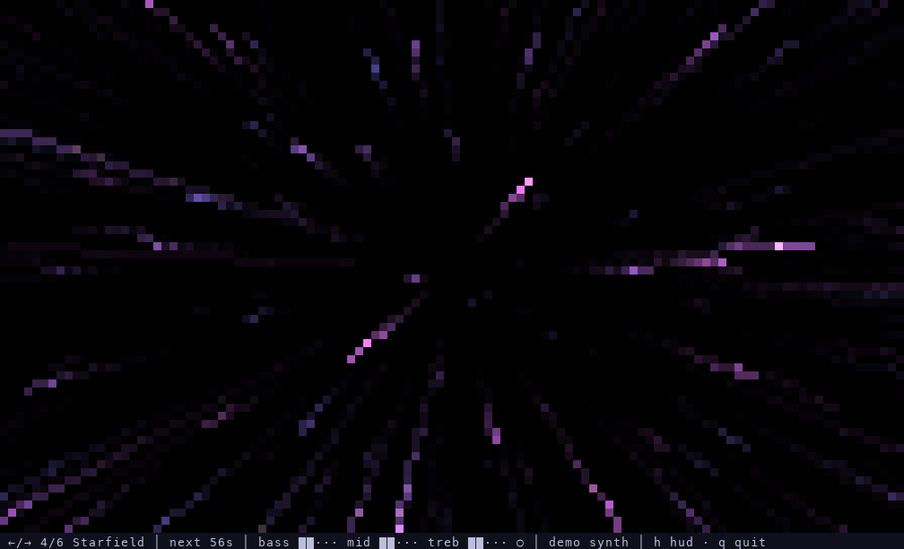

# console-demo-screen

Old-school demoscene effects in your terminal, driven by whatever music you're playing.

I wanted something to put on a second screen while music is running: a plasma that speeds up with the bass, a tunnel that lurches forward on every kick, a fire that gets taller when the track gets louder. It runs in any truecolor terminal, needs no GPU, and on macOS it can listen straight to a single app (like the Chrome tab playing your music) without any loopback-driver setup.

| | |
|---|---|
|  |  |
|  |  |
|  |  |

## Effects

| Effect | Reacts to |
|---|---|
| **Spectrum** | 64-band log spectrum with falling peak caps; the background flashes on beats |
| **Plasma** | bass sets the speed, mids the zoom, treble shifts the colors; beats brighten it |
| **Tunnel** | bass pushes you forward, mids spin and twist the tunnel |
| **Starfield** | bass and beats kick it into warp; treble tints the stars |
| **Fire** | bass feeds the flames, loudness sets their height, beats throw sparks |
| **Scope** | circular oscilloscope of the waveform, with mirrored spectrum spikes around it |

Effects rotate every 60 seconds. You can also flip through them with the arrow keys.

## Building

You need a recent stable Rust toolchain (edition 2024).

```sh
cargo build --release
```

The binary ends up in `target/release/console-demo-screen`.

## Running

The quickest way to see something is the built-in demo track. It needs no audio device:

```sh
./target/release/console-demo-screen --demo
```

### Listening to an app (macOS 14.4+)

This is what I use day to day. It taps the audio output of one app directly through Core Audio. The sound still goes to your speakers or headphones as usual, and the volume keys keep working.

```sh
# see which apps are currently known to the audio system (▶ = playing)
./target/release/console-demo-screen --list-apps

# visualize Chrome
./target/release/console-demo-screen --tap chrome
```

`--tap` matches on a part of the bundle ID, so `chrome` picks up `com.google.Chrome.helper`, the process that actually plays audio in Chrome. The first time you run it, macOS asks to allow "System Audio Recording" for your terminal app.

### Listening to an input device

The default is your system's default input device, which is usually the microphone. That works surprisingly well with speakers. To pick a different device:

```sh
./target/release/console-demo-screen --list-devices
./target/release/console-demo-screen --device "macbook pro"
```

To visualize system audio on macOS without `--tap`, you can also go the classic loopback route. Install [BlackHole](https://github.com/ExistentialAudio/BlackHole), create a Multi-Output Device in Audio MIDI Setup with your speakers and BlackHole, make it the system output, and run with `--device blackhole`.

### Bluetooth headphones

Bluetooth adds roughly 150–250 ms of latency. The app hears the audio *before* it reaches your ears, so the visuals end up slightly ahead of the beat. `--delay` holds the visuals back to compensate:

```sh
./target/release/console-demo-screen --tap chrome --delay 200
```

Tune the value by ear until the kicks and the flashes line up.

## Keys

| Key | Action |
|---|---|
| `←` / `→` | previous / next effect (also resets the rotation timer) |
| `h` | toggle the status line |
| `q`, `Esc`, `Ctrl-C` | quit |

## Options

```
    --demo                 Use a built-in synthetic track instead of an audio device
-t, --tap <APP>            Capture an app's audio output (macOS 14.4+), matched by bundle ID
-d, --device <DEVICE>      Input device (case-insensitive substring), e.g. "BlackHole"
    --list-apps            List apps known to the audio system and exit
    --list-devices         List input devices and exit
    --delay <MS>           Delay the visuals, e.g. ~200 for Bluetooth headphones (0–2000)
    --interval <SECONDS>   Seconds before auto-rotating to the next effect [default: 60]
    --fps <FPS>            Target frames per second [default: 30]
    --meter <SECONDS>      Print audio levels and beats instead of starting the UI
```

## Troubleshooting

**Nothing moves.** Run with `--meter 5`. It prints the raw peak and the normalized levels twice a second and marks detected beats. If `peak` stays at `0.0000`, no audio is reaching the app. Check that the app you tap is actually playing, that the right device is selected, and that your terminal has the Microphone or System Audio Recording permission in System Settings → Privacy & Security.

**Choppy output.** Rendering is just a lot of ANSI escape codes, so the terminal does most of the work. A smaller window or `--fps 20` helps. GPU-accelerated terminals (iTerm2, kitty, WezTerm, Ghostty) cope best.

**Headphones sound bad / spectrum looks cut off above 8 kHz.** Bluetooth headsets switch to a 16 kHz hands-free mode whenever their microphone is in use. Set your input device to something else, such as the built-in mic, and they go back to full-quality stereo.

## How it works

Every frame, the app takes the latest 2048 samples and runs a Hann-windowed FFT. From that it derives bass/mid/treble energy, a log-spaced spectrum, the waveform and a simple beat detector: bass energy jumping well above its recent average. All values are auto-gained against a slowly decaying peak, so a quiet microphone and a loud loopback produce similar visuals.

Effects draw into an RGB buffer. Each terminal cell holds two pixels using the upper half-block character `▀`, with the foreground color as the top pixel and the background color as the bottom one. The whole frame goes out as one write of truecolor escape codes.

The macOS app tap uses the Core Audio process tap API (`CATapDescription` + a private aggregate device). Nothing is recorded or stored. The audio is only analyzed in memory.

## License

No license has been chosen yet.
